<p align="center">
  <a href="https://github.com/BudGI-Team/BudGi">
    
  </a>
</p>

<h1 align="center">BudGi</h1>

<p align="center">
  <strong>Production-grade, privacy-first personal finance platform and automated budgeting ecosystem.</strong><br />
  Featuring a reactive React 18 web dashboard, an offline-first native Android client with automated bank SMS parsing, and an on-demand financial Copilot powered by the Groq Llama-3 inference engine.
</p>

<p align="center">
  <a href="https://github.com/BudGI-Team/BudGi/releases/latest">
    
  </a>
  <a href="https://github.com/BudGI-Team/BudGi/actions/workflows/android-release.yml">
    
  </a>
  <a href="https://github.com/BudGI-Team/BudGi/blob/main/LICENSE">
    
  </a>
  <a href="https://nodejs.org/">
    
  </a>
  <a href="https://react.dev/">
    
  </a>
  <a href="https://kotlinlang.org/">
    
  </a>
  <a href="https://developer.android.com/jetpack/compose">
    
  </a>
  <a href="https://www.mongodb.com/">
    
  </a>
  <a href="https://redis.io/">
    
  </a>
  <a href="https://groq.com/">
    
  </a>
</p>

<p align="center">
  <a href="#-architecture--system-design"><strong>System Architecture</strong></a> •
  <a href="#-key-capabilities"><strong>Key Capabilities</strong></a> •
  <a href="#-interface-showcase"><strong>Screenshots</strong></a> •
  <a href="#-quick-start"><strong>Quick Start</strong></a> •
  <a href="#-environment-configuration"><strong>Environment</strong></a> •
  <a href="#-api-specification"><strong>API Reference</strong></a> •
  <a href="#-android-application"><strong>Android Native</strong></a> •
  <a href="#-contributing"><strong>Contributing</strong></a>
</p>

---

## 💡 Overview & Problem Statement

Most personal finance applications fail modern users in three critical ways:
1. **Aggregator Dependency & Privacy Compromise**: Solutions relying on third-party banking aggregators (Plaid, Yodlee) store consumer banking credentials or sell anonymized purchase histories to advertisers.
2. **Friction-Induced Abandonment**: Manual entry workflows inevitably lead to tracking fatigue, leaving records stale and inaccurate.
3. **Siloed Client Architecture**: Web-only dashboards miss out on on-device payment alerts, while mobile-only apps lack deep analytics, batch imports, and multi-user collaborative ledgers.

**BudGi eliminates these trade-offs.** It is an open-source, dual-client personal finance ecosystem designed for self-hosting or managed deployment:
- **Zero-Credential Automated Capture**: A high-priority native Android broadcast receiver intercepts transactional bank SMS (UPI, Debit, Credit, ATM, NetBanking) and extracts amount, merchant, type, and account balance on-device using regex tokenizers with LLM fallback.
- **Sub-50ms Reactive State**: A persistent bi-directional WebSocket hub mirrors ledger modifications across native Android, desktop browsers, and tablet layouts in real-time.
- **Offline-First Resilience**: Full Room database mirroring on Android coupled with a WorkManager background sync queue ensures zero data loss when transacting in low-connectivity areas.
- **Private Financial Intelligence**: Powered by Groq's low-latency Llama-3 inference pipeline, BudGi provides context-aware anomaly explanations, monthly budget forecast models, and natural language copilot queries without sending raw banking credentials to external servers.

---

## 🏛️ Architecture & System Design

BudGi operates on an event-driven, modular micro-monorepo architecture. Below is the end-to-end data flow between edge clients, ingestion streams, processing engines, and persistent databases:

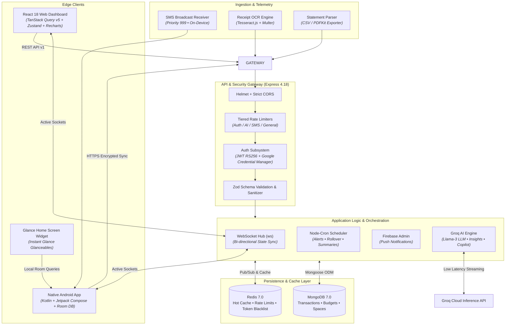

---

## 📸 Interface Showcase

BudGi ships with responsive dark and light design systems engineered for high visual ergonomics and readability.

### Web Dashboard & Mobile Ecosystem

| Surface | Dark Mode | Light Mode |
| :--- | :---: | :---: |
| **Financial Dashboard**<br/>_Real-time cash flow, category velocity, and interactive wealth metrics._ | 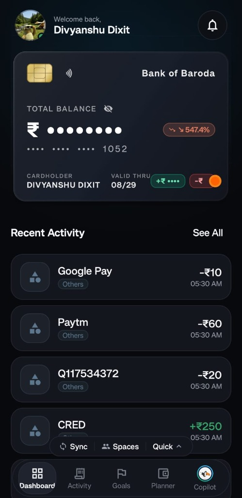 | 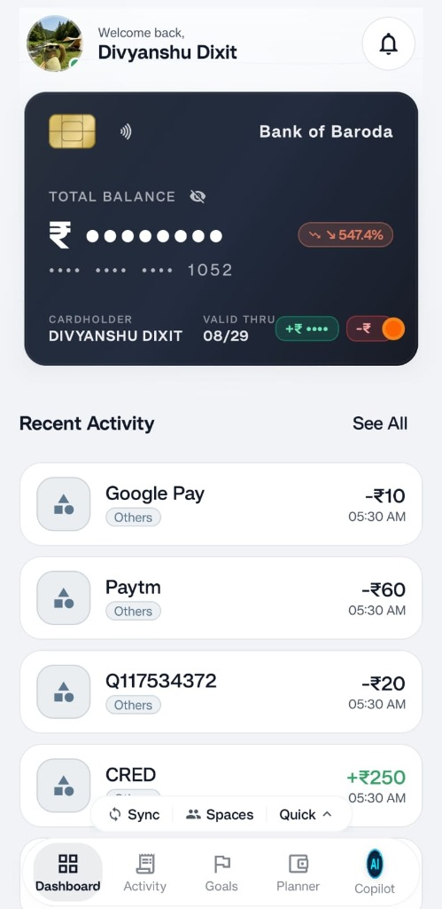 |
| **AI Copilot & Insights**<br/>_Natural language financial querying, anomaly breakdowns, and budget forecasts._ | 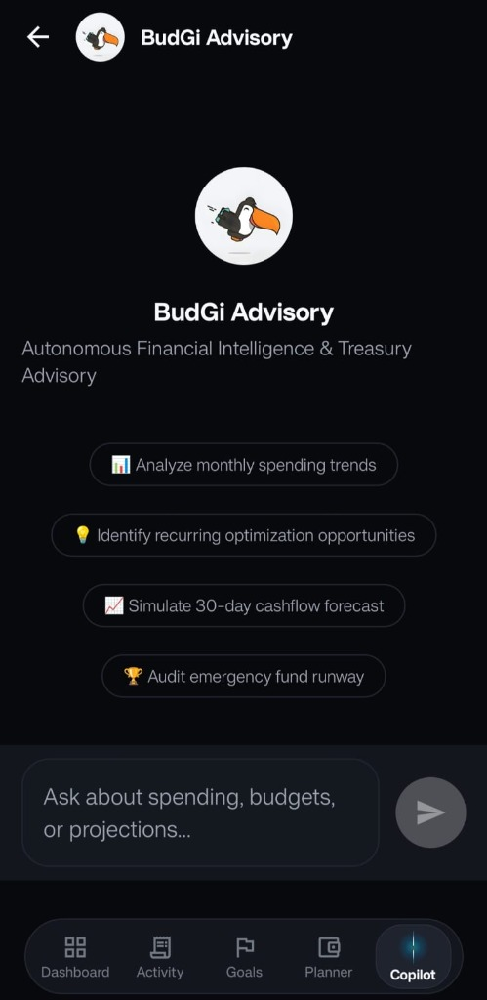 | 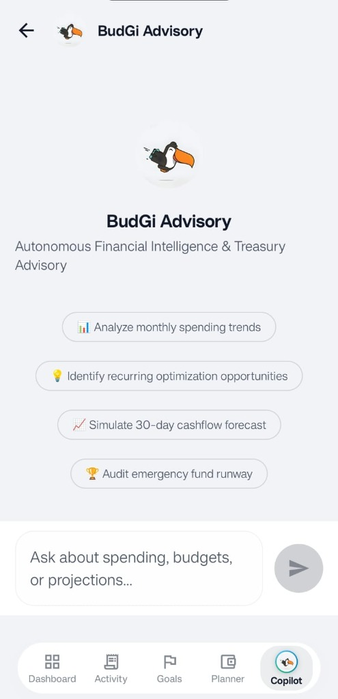 |
| **Envelope Budgets & Planner**<br/>_Dynamic category allocations, threshold warnings (80% / 100%), and rollover management._ | 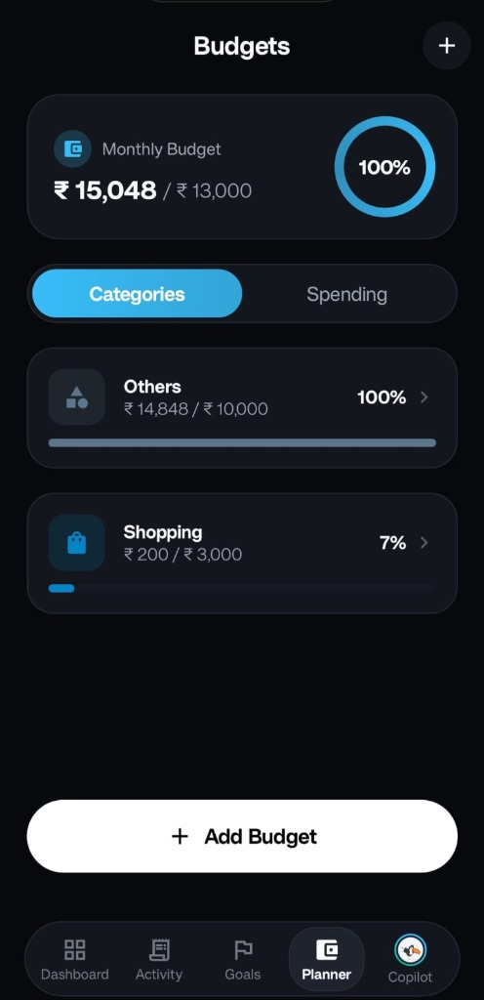 | 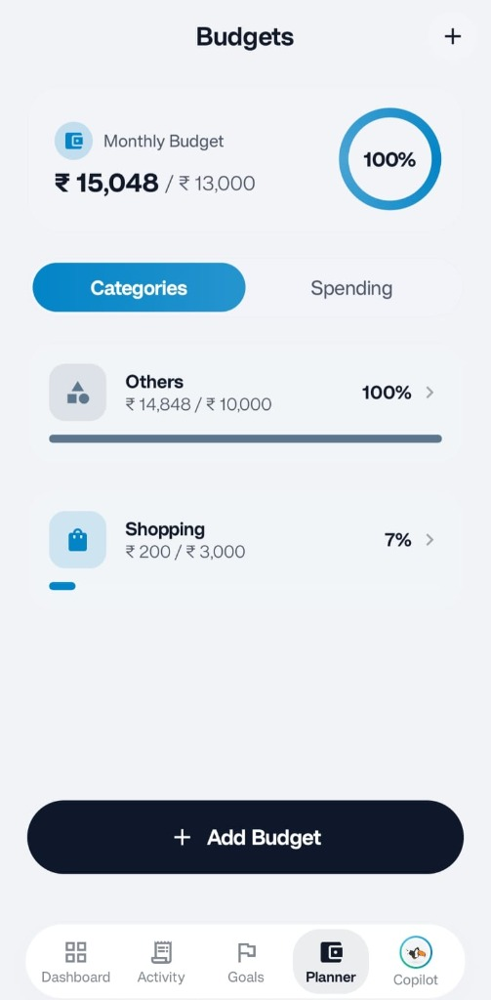 |
| **Savings Goals & Milestones**<br/>_Progress tracking, automated target recommendations, and projected fulfillment dates._ | 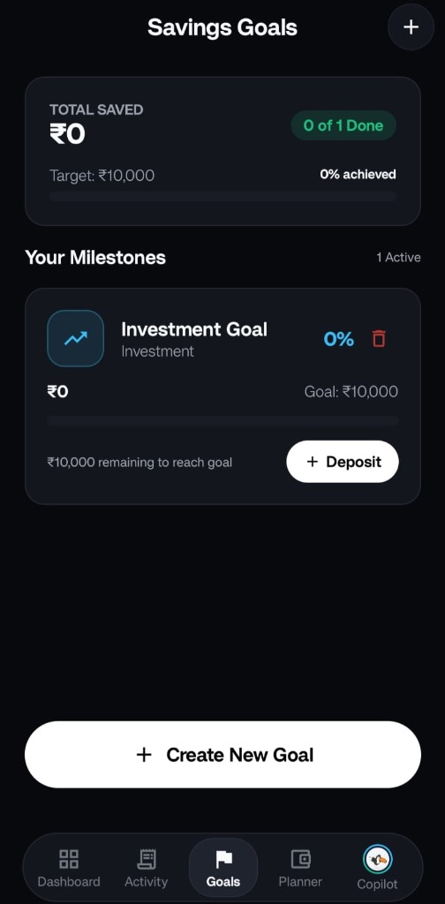 | 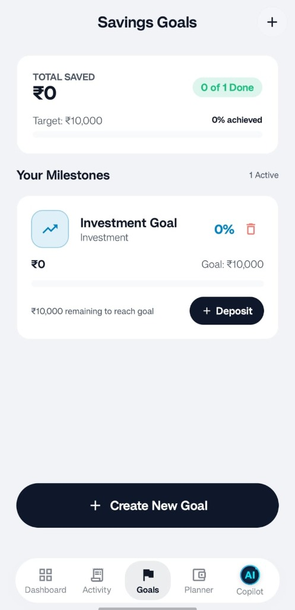 |
| **Transactions & Audit Stream**<br/>_Searchable history, receipt image previews, category tags, and instant filtering._ | 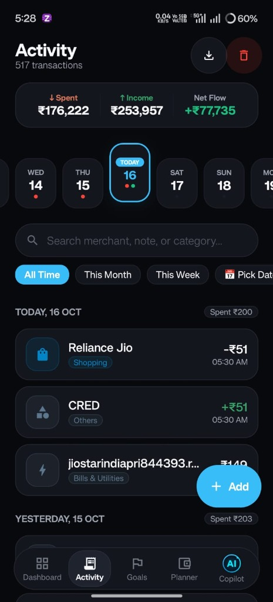 | 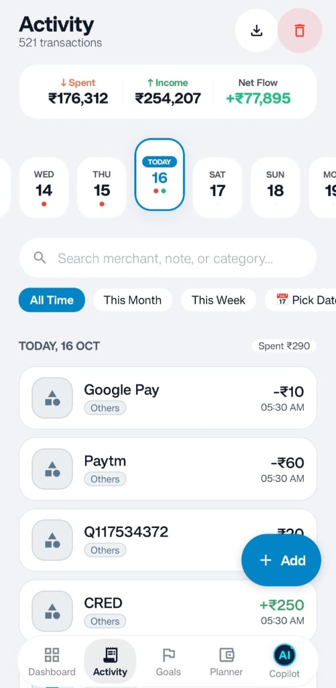 |

---

## ✨ Key Capabilities

### 1. Zero-Friction SMS Transaction Engine (Android)
- **High-Priority Broadcast Listener**: Captures transactional SMS in real-time (`android.provider.Telephony.SMS_RECEIVED` priority 999).
- **Dual-Phase Parser**:
  1. *Deterministic Regex Matching*: Extracts transaction amount, type (Debit/Credit/UPI/ATM), balance, merchant name, and reference number for 25+ major financial institutions (HDFC, SBI, ICICI, Axis, Kotak, PayTM, PhonePe, Google Pay, CRED, etc.).
  2. *Groq LLM Fallback*: If non-standard syntax is encountered, a background task leverages the Groq SDK to reliably infer the transaction payload without dropping records.
- **Actionable Notifications**: Instant heads-up notification with deep links for one-tap category overrides (`ACTION_QUICK_CATEGORIZE`) and debt reconciliation (`SETTLE_SPLIT_DEBT`).

### 2. Conversational Financial Copilot (Groq SDK)
- **LLM Context Injection**: Evaluates user spending velocity, active envelopes, and upcoming bills to provide immediate, actionable answers.
- **Anomaly Detection**: Monitors irregular expenditure deviations from historical moving averages and generates plain-language explanations.
- **Payday Blueprinting**: Automatically calculates dynamic split percentages (e.g. 50/30/20 or custom ratios) when income transactions land.

### 3. Collaborative Shared Spaces
- **Multi-Member Ledgers**: Create shared budgeting spaces with family, roommates, or travel groups.
- **Automated Bill Splitting**: Split individual items evenly, by percentages, or exact amounts with automatic net-balance simplification.
- **Real-Time Synchronized Balances**: All participants receive instant updates on new expenses and settlements via WebSocket broadcasts.

### 4. Enterprise-Grade Security Envelope
- **Input Sanitization**: Multi-stage prototype pollution filtering and NoSQL query injection stripping across all JSON and query inputs.
- **Tiered Rate Limiting**: Independent rate limit buckets for public auth (`20 req/15m`), AI generation (`30 req/15m`), and general telemetry (`200 req/15m`).
- **Encrypted Local Storage**: Android tokens and session keys are secured using `EncryptedSharedPreferences` backed by the hardware Android Keystore.
- **Biometric Authentication**: Native biometric unlock (Fingerprint / Face Unlock via AndroidX Biometric API) guarding sensitive views.

---

## 🗂️ Repository Structure

BudGi is maintained as a unified repository encompassing the complete web client, server runtime, and native Android application:

```text
BudGi/
├── .github/
│   └── workflows/
│       └── android-release.yml   # Automated GitHub Action building signed release APKs
├── assets/                       # High-resolution logos, brand icons, and UI mockups
├── docker-compose.yml            # Containerized MongoDB 7.0 and Redis 7.0 services
│
├── BudGi-production/             # Web & Backend Monorepo
│   ├── package.json              # Monorepo workspaces, unified linting & formatting scripts
│   │
│   ├── client/                   # Web Client Application
│   │   ├── index.html            # SPA Entrypoint
│   │   ├── vite.config.js        # Vite bundler configuration
│   │   └── src/
│   │       ├── components/       # Design system primitives, charts, modals, wealth orb
│   │       ├── hooks/            # Custom query and WebSocket subscription hooks
│   │       ├── pages/            # Dashboard, AIChat, Budgets, Analytics, Goals, Settings
│   │       ├── store/            # Zustand persistent state stores
│   │       └── lib/              # Axios instance, token interceptors, formatters
│   │
│   └── server/                   # Core REST & Realtime Backend
│       ├── package.json          # Node dependencies & Jest configuration
│       ├── API_REFERENCE.md      # Canonical REST endpoint contract documentation
│       └── src/
│           ├── server.js         # HTTP server boot sequence, socket attachment & graceful exit
│           ├── app.js            # Express application middleware pipeline & route mounts
│           ├── config/           # Database connections (Mongoose, Redis) and env validation
│           ├── middleware/       # Security headers, rate limiters, auth guards, error handler
│           ├── utils/            # Structured logger, WebSocket hub, notification dispatcher
│           ├── jobs/             # Node-cron background schedules (alerts, summaries)
│           └── modules/          # Modular Controller-Service-Repository architecture
│               ├── ai/           # Groq SDK LLM prompt engineering and streaming handlers
│               ├── alerts/       # Multi-channel notification rules and alerts
│               ├── analytics/    # Trend models, predictive cash flow, category breakdowns
│               ├── auth/         # JWT generation, password hashing, Google token verification
│               ├── budgets/      # Envelope allocations, threshold checks, rollover algorithms
│               ├── goals/        # Savings milestone calculations and deposits
│               ├── mobile/       # Device token registrations and Digital Asset Links
│               ├── sms/          # Transactional bank SMS parsing engine and regex catalog
│               ├── spaces/       # Multi-user shared spaces, expense splits, debt settlement
│               ├── sync/         # Incremental state reconciliation & offline event buffer
│               └── transactions/ # CRUD operations, receipt OCR (Tesseract), PDF/CSV exports
│
└── android-app/                  # Native Android Client
    ├── build.gradle.kts          # Root Gradle script
    ├── settings.gradle.kts       # Module declarations
    └── app/
        ├── build.gradle.kts      # Compose M3, Hilt, Room, Retrofit, Glance dependencies
        ├── proguard-rules.pro    # R8 code shrinking and obfuscation rules
        └── src/main/
            ├── AndroidManifest.xml # Permissions, broadcast receivers, deep link filters
            ├── java/com/app/
            │   ├── FinanceApplication.kt # Hilt application class, notification channels
            │   ├── di/                   # Dependency injection modules (Network, Database)
            │   ├── data/
            │   │   ├── local/            # Room database, DAOs, entities
            │   │   ├── remote/           # Retrofit interfaces, DTOs, WebSocket listener
            │   │   ├── repository/       # Repository implementations & offline-first caches
            │   │   ├── sms/              # SmsReceiver, regex tokenizers, quick action receivers
            │   │   ├── sync/             # WorkManager sync workers and network watchdog
            │   │   └── updater/          # In-app APK updater matching cryptographic release
            │   ├── domain/               # Core domain models, business engines, use cases
            │   ├── presentation/         # Jetpack Compose UI screens, view models, themes
            │   │   └── widget/           # Android Glance home screen app widget
            │   └── security/             # Biometric manager & encrypted keystore wrappers
            └── res/                      # Vector drawables, layout configs, XML shortcuts
```

---

## 🚀 Quick Start

### Prerequisites
Make sure your workstation meets the following requirements:
- [Node.js](https://nodejs.org/) `>= 18.0.0`
- [npm](https://www.npmjs.com/) `>= 9.0.0`
- [Docker Engine](https://docs.docker.com/engine/install/) & Docker Compose (for local database services)
- [Java Development Kit (JDK)](https://adoptium.net/) `17` (required only for building the native Android app)
- [Android Studio](https://developer.android.com/studio) Ladybug or newer (for Android development)

---

### Step 1: Clone the Repository
```bash
git clone https://github.com/BudGI-Team/BudGi.git
cd BudGi
```

### Step 2: Spin Up Infrastructure (MongoDB & Redis)
Use the root Docker Compose file to launch isolated MongoDB 7.0 and Redis 7.0 instances:
```bash
docker compose up -d
```
Verify containers are running:
```bash
docker compose ps
```

---

### Step 3: Configure Environment Variables

**Backend Configuration:**
```bash
cp BudGi-production/server/.env.example BudGi-production/server/.env
```
Edit `BudGi-production/server/.env` and supply your secrets:
```ini
MONGO_URI=mongodb://localhost:27017/budgi
JWT_SECRET=super_secure_random_string_at_least_32_characters_long
GROQ_API_KEY=your_groq_api_key_from_console_groq_com
REDIS_URL=redis://localhost:6379
```

**Frontend Configuration:**
```bash
cp BudGi-production/client/.env.example BudGi-production/client/.env
```
Default points to the local backend:
```ini
VITE_API_URL=http://localhost:5000
```

---

### Step 4: Install Dependencies & Run Monorepo

From the monorepo root (`BudGi-production`):
```bash
cd BudGi-production
npm run install:all
```

Run both backend and client concurrently in separate terminals:

**Terminal 1 — API Server:**
```bash
npm run dev:server
# Server boots on http://localhost:5000
# Health check available at: http://localhost:5000/health
```

**Terminal 2 — React Client:**
```bash
npm run dev:client
# Vite dev server starts at: http://localhost:5173
```

Navigate to `http://localhost:5173` in your browser to begin onboarding.

---

## ⚙️ Environment Configuration

The backend performs strict validation on boot via `src/config/env.js`. Missing required variables will prevent execution:

| Variable | Required | Default | Description |
| :--- | :---: | :---: | :--- |
| `MONGO_URI` | **Yes** | `mongodb://localhost:27017/budgi` | Connection string for MongoDB instance or cluster |
| `JWT_SECRET` | **Yes** | — | Cryptographic secret used for signing JWTs (`min 32 chars`) |
| `NODE_ENV` | No | `development` | Runtime mode: `development`, `production`, or `test` |
| `PORT` | No | `5000` | Port on which the Express HTTP and WebSocket server listens |
| `CLIENT_ORIGIN` | No | `http://localhost:5173` | Allowed CORS origins (comma-separated for multiple domains) |
| `JWT_EXPIRES_IN` | No | `7d` | Lifetime of issued authentication tokens |
| `GROQ_API_KEY` | No | — | Required for AI Copilot, anomaly explanations, and smart categorizations |
| `REDIS_URL` | No | — | Redis connection URL. Falls back to in-memory map cache if unset |
| `RATE_LIMIT_WINDOW_MS` | No | `900000` (15m) | Rolling window for rate limiting in milliseconds |
| `RATE_LIMIT_MAX` | No | `200` | Max requests per window for standard endpoints |
| `RATE_LIMIT_AUTH_MAX` | No | `20` | Max requests per window for `/api/v1/auth/*` routes |
| `RATE_LIMIT_AI_MAX` | No | `30` | Max requests per window for `/api/v1/ai/*` routes |
| `RATE_LIMIT_SMS_MAX` | No | `50` | Max requests per window for `/api/v1/sms/*` batch ingestion |
| `ANDROID_PACKAGE_NAME` | No | `com.budgi.app` | Android package name for Digital Asset Links verification |
| `ANDROID_CERT_FINGERPRINTS` | No | — | Comma-separated SHA-256 fingerprints for deep link binding |
| `FIREBASE_SERVICE_ACCOUNT_PATH` | No | — | Path to Firebase Admin service credentials JSON for push notifications |

---

## 📡 API Specification & Data Contracts

All endpoints enforce a uniform response envelope for predictable client consumption.

### Uniform Response Envelopes

```json
// Success Response (200 OK / 201 Created)
{
  "success": true,
  "message": "Transactions retrieved successfully",
  "data": [ ... ],
  "meta": {
    "page": 1,
    "limit": 50,
    "total": 142,
    "pages": 3
  }
}

// Error Response (400 / 401 / 403 / 404 / 500)
{
  "success": false,
  "message": "Validation failed on submitted payload",
  "data": null,
  "errors": [
    {
      "field": "amount",
      "message": "Transaction amount must be a positive number"
    }
  ]
}
```

### Core API Endpoints

| Method | Canonical Endpoint | Auth | Description |
| :--- | :--- | :---: | :--- |
| `GET` | `/health` | No | Server operational status, uptime, and API versions |
| `POST` | `/api/v1/auth/register` | No | Create user account with initial currency and income profile |
| `POST` | `/api/v1/auth/login` | No | Authenticate user and receive JWT bearer token |
| `GET` | `/api/v1/auth/me` | **Yes** | Fetch active user credentials, settings, and profile details |
| `GET` | `/api/v1/transactions` | **Yes** | Paginated transaction list with category and date filtering |
| `POST` | `/api/v1/transactions` | **Yes** | Record transaction with auto-categorization and budget impact |
| `POST` | `/api/v1/transactions/receipt` | **Yes** | Upload receipt image for automated Tesseract OCR parsing |
| `GET` | `/api/v1/transactions/export/csv` | **Yes** | Stream transaction ledger as RFC 4180 compliant CSV |
| `GET` | `/api/v1/transactions/export/pdf` | **Yes** | Generate and download formal PDF financial summary report |
| `GET` | `/api/v1/budgets` | **Yes** | Retrieve category allocations, spent totals, and health status |
| `POST` | `/api/v1/budgets` | **Yes** | Set category spending limits and threshold alert levels |
| `POST` | `/api/v1/ai/chat` | **Yes** | Stream conversational financial advice via Groq LLM |
| `GET` | `/api/v1/ai/insights` | **Yes** | Fetch calculated monthly spending projections and anomalies |
| `POST` | `/api/v1/sms/parse` | **Yes** | Ingest raw SMS text string and return structured financial object |
| `POST` | `/api/v1/sms/batch` | **Yes** | Synchronize historical offline SMS batch from native Android client |
| `GET` | `/api/v1/spaces` | **Yes** | List user's active multi-person shared budgeting spaces |
| `POST` | `/api/v1/spaces/:id/expenses` | **Yes** | Record shared group expense with automatic net debt resolution |
| `GET` | `/api/v1/sync` | **Yes** | Incremental sync delta for client state reconciliation |

> Complete REST contract specifications, request parameters, and response models are maintained in [API_REFERENCE.md](BudGi-production/server/API_REFERENCE.md).

---

## 📱 Android Native Application

The Android client (`android-app/`) is built using **modern Android development best practices** (MAD) with zero XML layout legacy.

### Architecture Highlights
- **Jetpack Compose + Material 3**: Declarative UI supporting dynamic theming and high-refresh edge-to-edge layouts.
- **Dagger Hilt**: Compile-time dependency injection across ViewModels, Repositories, DAOs, and Workers.
- **Room Database**: Local-first SQLite abstraction with Room Kotlin Symbol Processing (KSP). All operations read from and write to the local Room cache first, then asynchronously sync to the cloud backend.
- **Glance AppWidget**: Native home screen widget providing real-time daily expenditure progress and one-tap quick transaction logging.
- **In-App Release Updates**: Built-in release engine queries the GitHub Releases API for tagged updates. If a newer signed build is published, BudGi downloads and installs it directly in-place without losing offline state.

### Building from Source

```bash
cd android-app

# Run unit and coroutine test suites
./gradlew test

# Build debug APK (points to local or staging backend)
./gradlew assembleDebug

# Build release signed APK with R8 obfuscation
./gradlew assembleRelease
```
The output release APK will be placed in `android-app/app/build/outputs/apk/release/BudGi.apk`.

### Direct APK Download
Production builds are continuously compiled and signed via GitHub Actions:
- **[Download Latest BudGi.apk](https://github.com/BudGI-Team/BudGi/releases/latest/download/BudGi.apk)**

---

## 🧪 Testing, Quality & Code Integrity

Every commit to BudGi is verified against strict formatting, linting, and automated test suites:

```bash
cd BudGi-production

# 1. Run backend integration and module tests (Jest)
npm run test --prefix server

# 2. Run ESLint checks across client and server
npm run lint

# 3. Format entire monorepo using Prettier
npm run format
```

For Android testing:
```bash
cd android-app

# Run Room database, Coroutine and ViewModel unit tests
./gradlew testDebugUnitTest
```

---

## 🗺️ Roadmap & Ecosystem Milestones

- [x] **v1.0**: Core Express backend, React SPA, and basic manual transaction logging.
- [x] **v2.0**: Native Kotlin Android app with high-priority SMS parsing and Room offline synchronization.
- [x] **v2.5**: Shared Spaces with automated split debt minimization and WebSockets sync.
- [x] **v3.0**: Migration to Groq SDK Llama-3 inference, Tesseract OCR receipt scanner, and Glance AppWidgets.
- [ ] **v3.2**: Integration with India's RBI Account Aggregator (AA) framework for consent-based multi-bank statement fetch.
- [ ] **v3.5**: Wear OS companion app for rapid tap-to-log expense entry and budget progress complications.
- [ ] **v4.0**: On-device quantized local LLM execution via ONNX Runtime for 100% air-gapped financial advice.

---

## 🤝 Contributing

We welcome contributions from the community. To contribute to BudGi:

1. **Fork the Repository** and clone your fork locally.
2. **Create a Feature Branch**:
   ```bash
   git checkout -b feat/your-feature-name
   ```
3. **Commit Your Changes** adhering to [Conventional Commits](https://www.conventionalcommits.org/):
   ```bash
   git commit -m "feat(sms): add regex pattern parser for ICICI credit card alerts"
   ```
4. **Verify Tests & Linters**:
   Ensure all tests pass and no linter warnings are present before pushing.
5. **Open a Pull Request**: Submit your PR against the `main` branch with a concise summary of the rationale, architecture impacts, and testing evidence.

---

## 📄 License & Maintainers

BudGi is distributed under the open-source **[MIT License](LICENSE)**.

### Maintainers & Core Engineers
- **Anuj Rathore** — [@anujrathore9](https://github.com/anujrathore9)
- **Divyanshu Dixit** — [@DivyanshuDixit01](https://github.com/DivyanshuDixit01)

<p align="center">
  <sub>Built with care for financial privacy, performance, and transparency.</sub>
</p>
